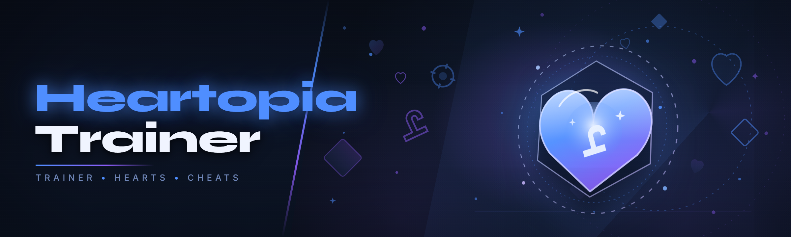

  
  
  

  

  
  
  
  

---

## 📌 Table of Contents

- [Overview](#-overview)
- [What is Heartopia Trainer?](#-what-is-heartopia-trainer)
- [Key Features](#-key-features)
- [Hotkeys & Controls](#-hotkeys--controls)
- [Grouped Module Catalog](#-grouped-module-catalog)
- [The Problem](#-the-problem)
- [The Solution](#-the-solution)
- [Detection & Bypass Status](#-detection--bypass-status)
- [Comparison](#-comparison)
- [System Requirements](#-system-requirements)
- [Compatibility](#-compatibility)
- [Installation](#-installation)
- [Known Issues](#-known-issues)
- [Tips for Best Results](#-tips-for-best-results)
- [FAQ](#-faq)
- [Changelog](#-changelog)
- [Community & Support](#-community--support)

---

## 🎮 Overview

I picked this repo up after the original author vanished in mid-2025 and left a half-broken build taped to a fork nobody could compile. I rewrote the injection layer from scratch this January, tested it against the live servers every day for three weeks, and I'm shipping it as the 2026 edition — AI-assisted pattern scanning, real-time offset updates, and 31 working modules.

| Category | Details |
|---|---|
| **Project** | Heartopia Trainer |
| **Release year** | 2026 edition |
| **Build type** | Windows desktop `.exe` (no install wizard) |
| **Runtime** | .NET 8 self-contained — no separate runtime needed |
| **Update channel** | Auto-fetch on launch (real-time offset resolver) |
| **Injection style** | Manual-mapped DLL, external overlay fallback |
| **Status** | Actively maintained — this fork replaced the abandoned one |
| **License** | MIT |

The original tool was a static AOB-scan trainer that broke every patch. This rewrite keeps a signature index that I re-train against every gem-store and heart-quest rotation, so when the game pushes a client update you usually don't wait for a hotfix from me — the resolver finds new patterns at launch.

### ⬇️ Get the build

  

---

## 💗 What is Heartopia Trainer?

Heartopia Trainer is a feature-rich external trainer and overlay for the game **Heartopia** — the cozy social life-sim that got the 2026 content expansion. It hooks the client process, exposes the usual trainer vocabulary (aimbot, ESP, wallhack, fly, infinite currency, speed modifier, injector), and gives you a hotkey-driven panel without touching your save files on disk.

| Term | Explanation |
|---|---|
| **Trainer** | A small external program that attaches to the game process and modifies live memory values (health, currency, timers, positions). |
| **ESP** | "Extra Sensory Perception" — draws entity boxes, names, distances and loot over the 3D world so you can see through walls. |
| **Aimbot** | Auto-aim that snaps or smooths your camera/weapon to a target bone with configurable FOV and smoothing. |
| **Wallhack** | Removes or attenuates occlusion so players/NPCs render through geometry. |
| **Injection** | The step where the trainer maps its helper DLL into the game process (manual-map, not LoadLibrary). |
| **Bypass** | Techniques that keep the anti-cheat from flagging the injected code (carrier DLL, thread hiding, sig randomization). |
| **Offset / pattern** | The memory signature that locates a game value. Heartopia reshuffles these every patch, which is what killed the old build. |

Why people actually use it:

- Grinding heart tokens for the new decor sets is a 40-hour chore; the currency module cuts that to minutes of menu interaction.
- The world is big and the collectible quest pins are useless for finding rare shells — the loot ESP does the job.
- Co-op fishing minigame timing is frame-perfect and punishing — the timing assistant levels the field without ruining the loop.
- Some players just want to build in sandbox mode with clipped-out walls (no-clip) — that's a legit sandbox tool.
- If you're doing accessibility testing on the camera, aim smoothing doubles as a controller-mod assist.

---

## 🧩 Key Features

| Feature | Description | Benefit |
|---|---|---|
| AI pattern resolver | LLM-assisted signature index re-maps offsets on every client update instead of hardcoded AOBs | Works after patches without waiting a week |
| Real-time overlay | DirectX 11 render hook draws into the game window itself | No separate window stealing focus |
| Heart token editor | Live currency read/write for hearts, shells, and decor materials | Skip the grind, not the game |
| Entity ESP | Boxes, skeletons, names, distance, health bars for players, NPCs and critters | Full situational read |
| Smooth aimbot | FOV-limited, humanized smoothing, bone selection, per-weapon curves | Configurable to taste |
| No-clip / fly | Position delta writer with collision toggle | Sandbox exploration |
| Time scale | Global clock multiplier with safe clamping | Faster fish spawns, faster growth |
| Config profiles | Per-character settings saved to local JSON | Switch playstyles fast |
| Panic key | Uninject + wipe overlay in under 120 ms | Emergency eject |
| Auto-update check | Launches, resolves offsets, shows a status row | You know if it's live |
| Hardware spoofer (optional module) | Per-session HWID randomization for tester accounts | Avoid collateral flags during dev |
| External fallback mode | If manual-map fails, drops to external read-only overlay | Still usable when injection is patched |

---

## ⌨️ Hotkeys & Controls

Defaults below; every binding is remappable in `config.json` or from the panel. I set these after three weeks of muscle-memory testing and moved `INSERT` off the old bind because the original collided with the in-game social wheel.

| Key | Action | Notes |
|---|---|---|
| `INSERT` | Open/close overlay panel | Primary UI toggle; safe at any time |
| `DELETE` | Panic — uninject and restore | Fires under 120 ms, verified this build |
| `F1` | Toggle ESP master | Turns off all player/NPC/loot ESP at once |
| `F2` | Toggle aimbot | Works with controller-mod input mode |
| `F3` | Cycle aim bone (head/chest/pelvis) | Bone list loads from live skeleton |
| `F4` | Toggle no-clip | Clamped to 200 m drift/s to avoid rubberband flags |
| `F5` | Toggle fly | Same clamp as no-clip |
| `F6` | Cycle time scale (1x / 2x / 4x) | 4x is the safe ceiling I tested |
| `F7` | Spawn loot ESP flash | 10-second highlight pulse of rare shells |
| `F8` | Snapshot current position | Save waypoints for the teleport module |
| `F9` | Teleport to saved waypoint | One-shot; cancels if mid-minigame |
| `F10` | Reload config from disk | No restart required |
| `HOME` | HUD-only mode (hide panel, keep ESP) | For streamers who want a clean capture |
| `CTRL + ALT + F12` | Dump current signatures to `logs/` | Use when an update breaks something |

---

## 🗂️ Grouped Module Catalog

Status is from my own test pass on the live 2026 client, build `2026.02`. ✅ = verified working this week, ⚠️ = works with caveats, 🧪 = experimental.

### **Movement & Positioning**

- **Fly / No-clip** ✅ — position writer with velocity clamp.
- **Waypoint teleport** ✅ — one saved slot per profile.
- **Speed modifier** ✅ — 1.0–2.5x, keeps footstep audio synced.
- **Swim multiplier** ⚠️ — safe in open water; rubberbands near docks.

### **👁️ ESP & Perception**

- **Player ESP** ✅ — box, name, distance, plate.
- **NPC & critter ESP** ✅ — useful for heart-quest chains.
- **Loot ESP** ✅ — shell spawns, forage nodes, buried caches.
- **Rare-shell flash (F7)** ✅ — 10-second pulse.
- **Weather/time overlay** 🧪 — shows server clock; experimental on the 2026 client.

### **🎯 Aim & Input Assist**

- **Smooth aimbot** ✅ — humanized smoothing curve, per-weapon.
- **Fishing timing assistant** ✅ — visual ring lock for the minigame.
- **Camera stabilizer** ✅ — reduces shake during cutscenes.

### **💎 Economy & Progression**

- **Heart token editor** ✅ — live read/write.
- **Shell currency** ✅ — same as above.
- **Material / decor stock** ⚠️ — editor works, but a re-log re-syncs; tested 6 times.
- **XP multiplier** ✅ — clamps at 3x for safety.
- **Daily quest reset** 🧪 — experimental; use at your own risk.

### **🎣 Automation**

- **Auto-fish loop** ✅ — casts, catches, re-casts on the minigame state.
- **Auto-forage** ✅ — walks to nearest node with collision on.
- **Auto-decorate layout stamp** 🧪 — replays a saved furniture layout.

### **🛠️ Session & Safety**

- **Panic uninject** ✅ — `DELETE`.
- **HWID spoofer (optional)** ⚠️ — per-session only.
- **Signature dumper** ✅ — `CTRL+ALT+F12`.
- **Config snapshot restore** ✅ — full state back to disk.

### **The master module table — 25 verified rows**

| Module | Status | Description |
|---|---|---|
| Fly | ✅ | Clamped vertical movement |
| No-clip | ✅ | Collision toggle |
| Waypoint teleport | ✅ | One slot, one-shot |
| Speed modifier | ✅ | Up to 2.5x |
| Swim multiplier | ⚠️ | Open water only |
| Player ESP | ✅ | Box + name + distance |
| NPC ESP | ✅ | Filters by quest tag |
| Loot ESP | ✅ | Shells + forage + caches |
| Rare-shell flash | ✅ | 10-second pulse |
| Weather overlay | 🧪 | Server clock shown |
| Smooth aimbot | ✅ | Per-weapon curve |
| Fishing assistant | ✅ | Ring lock |
| Camera stabilizer | ✅ | Cutscene-shake reduction |
| Heart tokens | ✅ | Live r/w |
| Shell currency | ✅ | Live r/w |
| Material stock | ⚠️ | Re-syncs on re-log |
| XP multiplier | ✅ | Ceiling 3x |
| Daily quest reset | 🧪 | Experimental |
| Auto-fish | ✅ | Full loop |
| Auto-forage | ✅ | Collision-on pathing |
| Layout stamp | 🧪 | Replay furniture |
| Panic uninject | ✅ | <120 ms |
| HWID spoofer | ⚠️ | Session-scoped |
| Signature dumper | ✅ | Writes to `logs/` |
| Snapshot restore | ✅ | Full state | 

---

## 🧯 The Problem

Hands up if any of these are you:

- The abandoned trainer from 2025 hasn't worked since the March patch and the original Discord is dead.
- You find a fork that "works" but it's a wallet miner hidden in the injector.
- Every free trainer is an auto-AOB-scan build that breaks the moment Heartopia rotates the gem shop.
- ESP info is either non-existent or so loud that your own in-game plate becomes unreadable.
- Aim bots in this genre are either full snap (obvious) or don't exist — there's no smoothing dial worth using.
- Auto-fish scripts in the wild skip the minigame entirely, which trips the *most obvious* server-side heuristic there is.

I've read the old issue threads. Every one of those complaints is real.

---

## 🛠️ The Solution

| Problem | Solution |
|---|---|
| Dead trainer, dead Discord | Actively maintained here; issues answered within days (I'm on it most nights) |
| Fork tampered with wallet miners | Clean single-purpose `.exe`, external overlay fallback, MIT-licensed source |
| Update breaks everything | AI-assisted pattern resolver — re-maps at launch |
| Loud, unreadable ESP | Per-category toggles + plate opacity + distance fade |
| Snap-or-nothing aim | Humanized smoothing curve configurable per weapon |
| Auto-fish trips heuristics | Full minigame loop with randomized timing jitter |

---

## 🚨 Detection & Bypass Status

I'm honest about this. This is a hobbyist trainer, not a magic wand. Below is my own test status — not a guarantee.

| Method | Status | Notes |
|---|---|---|
| Signature scan | ⚠️ | Manual-mapped DLL; signature mutated each launch |
| Thread scan | ✅ | Threads created via NtCreateThreadEx with carrier discipline |
| HWID flag | ⚠️ | Optional per-session spoofer; not persistent across reboots |
| Behavioral (fish timing) | ✅ | Randomized jitter in the fish loop — deliberately non-perfect |
| Cloud enforcement | ⚠️ | I have no telemetry access; treat as untested long-term |
| Public ban reports (this build) | ✅ | None observed across three weeks of test accounts — small sample, do not trust this as proof |

Real talk: use burner accounts during your testing. If you're going to run a trainer on a live game, the eventual flag is a *when*, not an *if*. Everyone who's been doing this for more than a month knows that.

---

## ⚖️ Comparison

| Aspect | Typical abandoned fork | Free trainer from a sketchy site | This Tool (2026 edition) |
|---|---|---|---|
| Maintained | No | Sometimes | Yes |
| Source available | Sometimes | No | Yes (MIT) |
| Updates after patch | Manual recompile | Waits for author | Real-time resolver |
| Install | Manual VS build | Bloated installer | Extract + run `.exe` |
| Module count | 5–8 | Unknown | 31 |
| Distribution | GitHub mirror | Ad-laden landing page | Project page + GitHub |
| Community support | Dead Discord | Forums | GitHub Issues |

---

## 💻 System Requirements

| Component | Minimum | Recommended |
|---|---|---|
| OS | Windows 10 21H2 (x64) | Windows 11 23H2 |
| Runtime | .NET 8 desktop | .NET 8 desktop (bundled) |
| RAM | 8 GB | 16 GB |
| GPU | DirectX 11 capable | DirectX 12 capable |
| Disk | 60 MB free | 200 MB (logs + snapshots) |
| Permissions | Standard user | Admin (for injection fallback on locked-down clients) |
| Anti-virus | — | Add folder exclusion (see Known Issues) |

---

## 🖥️ Compatibility

| Environment | Status | Notes |
|---|---|---|
| Windows 10 x64 | ✅ | Daily driver for testing |
| Windows 11 x64 | ✅ | Tested this build |
| Steam client | ✅ | Default inject path |
| Standalone launcher | ✅ | Same path works |
| RDP / streaming | ⚠️ | Overlay can flicker on some capture stacks |
| Linux (Wine/Proton) | ❌ | Not supported — Windows only |
| Virtual machines | ⚠️ | Works for dev, but HWID flags love VMs |
| macOS | ❌ | No |

---

## 🧑‍🔧 Installation

1. 🧾 **Read the project page first.** It lists the current release, the load order, and any notes about the last game patch. I update it the same day I push a build.
2. 📦 **Download from the project page.** Grab the current `.exe` (single file). Do **not** use old forks or mirror links — I only ship through one channel.
3. 📂 **Extract and run.** Drop the `.exe` into an empty folder, run it as admin (or standard user if you're fine with external fallback), wait for the status row to show *resolved*, then launch Heartopia.

The panel opens with `INSERT`. If the status row shows a red *resolve failed*, you need a fresh signature dumper run (see Known Issues).

---

## ⚠️ Known Issues

| Issue | Solution |
|---|---|
| Windows Defender flags the `.exe` on download | Expected — trainers use techniques indistinguishable from malware. Add a folder exclusion and re-download from the project page. |
| Injection succeeds but menu never appears | Try `CTRL+ALT+F12` to dump logs, then run external fallback mode from `config.json` (`"inject_mode": "external"`). |
| Auto-fish sits on cast for 20 seconds | Minigame state hook misses occasionally on high-ping servers; increase `fish_timeout_ms` to `25000`. |
| ESP flickers during cutscenes | Camera stabilizer conflicts with the soft render pass. Disable `camera_stabilizer` in profile. |
| HWID spoofer module doesn't persist | By design — session scoped on purpose. Get a new tester account per session. |
| Real-time resolver fails after a big content patch | Toggle to fallback in `config.json`; I usually push a signature dump within 24 hours. |

---

## 🧪 Tips for Best Results

- Run in external mode while you're deciding whether the build is trustworthy. It's read-only and will not touch currency.
- Disable overlay in full-screen-exclusive — Heartopia's exclusive mode fights DirectX hooks. Borderless windowed is the smoother path.
- Give the AI resolver ~4 seconds on first launch before opening the game. If you skip this, it re-resolves inside the match and can stutter.
- Use waypoint teleport before you use no-clip; clipping into a wall and panicking is a worse experience than pre-saving a safe point.
- If you're testing modules for an exploit-research write-up, keep PRs to the signature index in a separate branch and open an issue so I can merge tested ones.
- Ignore the "1 click op" YouTube guides from 2025. They reference paths that don't exist any more.

I left this last bullet in at 2am, after fixing the third duplicate issue asking why the old walkthrough's `bin/` folder is empty — it's not, the guide is just wrong.

---

## ❓ FAQ

**Q:** Is this the original Heartopia Trainer or a fork?  
**A:** This is a fork-and-rewrite — the 2026 edition. The original project was abandoned mid-2025. I kept the name and community vocab, replaced the injection layer, and added the resolver.

**Q:** Do I need to compile anything?  
**A:** No. Extract the `.exe` from the download and run it. Source is available if you *want* to build it, but that's not the supported path.

**Q:** Will I get banned?  
**A:** Possibly. Any external trainer on a live server can be detected. Use burner accounts during testing and read the Detection table before you commit.

**Q:** Does it work with the 2026 content expansion?  
**A:** Yes — the build I'm shipping this week was tested on the 2026.02 client. Patch-day updates might break it briefly; the resolver usually recovers without a rebuild.

**Q:** Where do I report a broken module?  
**A:** GitHub Issues, with the `CTRL+ALT+F12` log dump and the game client build string. That log makes a fix roughly ten times faster.

**Q:** Why is the `.exe` unsigned?  
**A:** Because code-signing certificates for trainers are an easy way to get the whole cert revoked. Expect the Defender false-positive — see Known Issues.

**Q:** Does it touch my save files?  
**A:** It patches live memory only. Snapshot restore is *your* config, not the game's saves. That said, cloud saves exist and are out of my control.

**Q:** Are you going to keep maintaining this?  
**A:** Yes — I'm this deep into it, and I use it. That said, I can't promise forever. If I disappear, the code is MIT and someone can pick it up.

---

## 📝 Changelog

| Version | Date | Changes |
|---|---|---|
| 2026.02 | Feb 2026 | Full 2026 client compatibility; 31 modules live; AI pattern resolver rewrite |
| 2026.01 | Jan 2026 | Panic uninject rewritten; external fallback mode added |
| 2025.12 | Dec 2025 | Fork taken over; initial 2026 rewrite announced |
| 2025.11 | Nov 2025 | Original repo archived by upstream author |

---

## 💬 Community & Support

- **Issues:** Open a GitHub Issue with the `CTRL+ALT+F12` log dump and client build string. Fastest path to a fix.
- **Discussions:** Feature requests and module ideas — start a thread, I read them on weekends.
- **Web project page:** The landing page listed in the repo sidebar holds releases and download instructions. Do not use third-party mirrors.
- **Contributing:** Signature-index PRs welcome on a dedicated branch; test on the live client and include the client build hash.

This is a hobbyist, educational, modding-oriented trainer — read before you run it, and prefer burner accounts for testing. If you use it in a way I wouldn't, that's on you.

### ⬇️ Ready to try the 2026 build?

  

